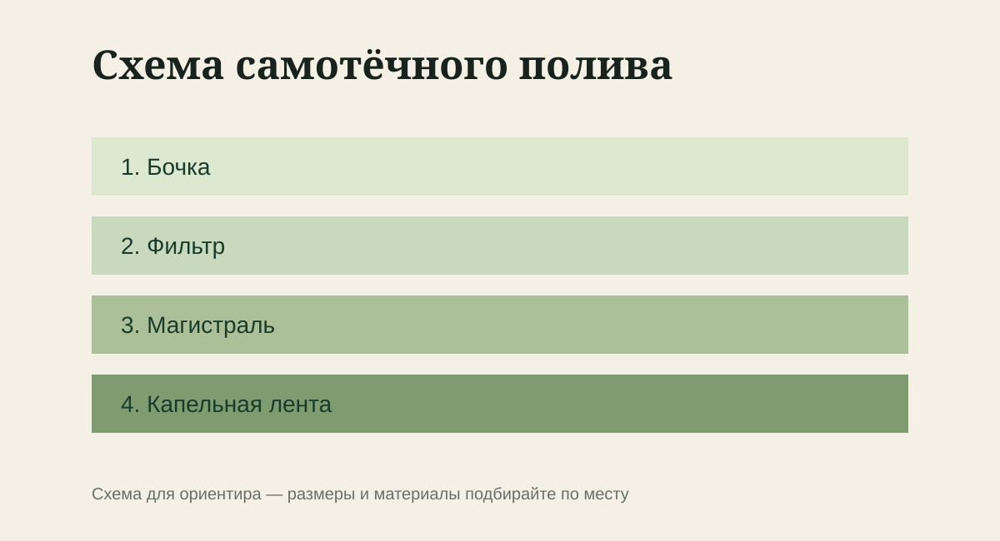

Как собрать полив самотёком, рассчитать линии и избежать засоров в жаркий сезон. В огороде полезно привязывать действия не к дате, а к фазе развития культуры и фактической погоде последних дней.

Для темы «Капельный полив из бочки» не нужен длинный список покупок. Полезнее заранее понять, что вы будете менять, и оставить исходное состояние для сравнения — хотя бы на фотографии.

## Подготовка

- сформулируйте ожидаемый результат для задачи «Капельный полив из бочки»;
- проверьте прогноз на два дня;
- оцените влажность на глубине 5–10 см;
- уберите больные и повреждённые остатки;
- подготовьте чистый инструмент и воду;

## Порядок работы

1. Поставьте бочку на устойчивое основание высотой 0,8–1,2 м.
2. На выходе установите кран и дисковый или сетчатый фильтр.
3. Проложите магистраль вдоль грядок и подключите ленты одинаковой длины.
4. Промойте систему с открытыми концами, затем закройте заглушки.
5. Подберите время полива по фактической влажности под капельницей.

> **Один приём за раз.** В работе с темой «Капельный полив из бочки» это помогает понять причину изменений и не перегрузить растения или конструкцию.

## После работы

- почва не остаётся постоянно мокрой;
- новые листья развиваются без деформации;
- растение не остановилось в росте после процедуры;
- режим ухода можно повторить без лишней нагрузки;
- сравните итог по теме «Капельный полив из бочки» с исходной фотографией;

## Где возникают проблемы

- начинать «капельный полив из бочки» в спешке, не проверив исходные условия;
- повторять процедуру автоматически, хотя причина уже изменилась;
- оценивать результат только по поверхности и не смотреть на влагу, крепления или состояние внутри системы.

## Коротко

Сохраните короткую запись: дата, погода, что именно сделали и что увидели через несколько дней. Для темы «Капельный полив из бочки» такая заметка полезнее универсальной схемы, потому что учитывает именно ваш участок.
