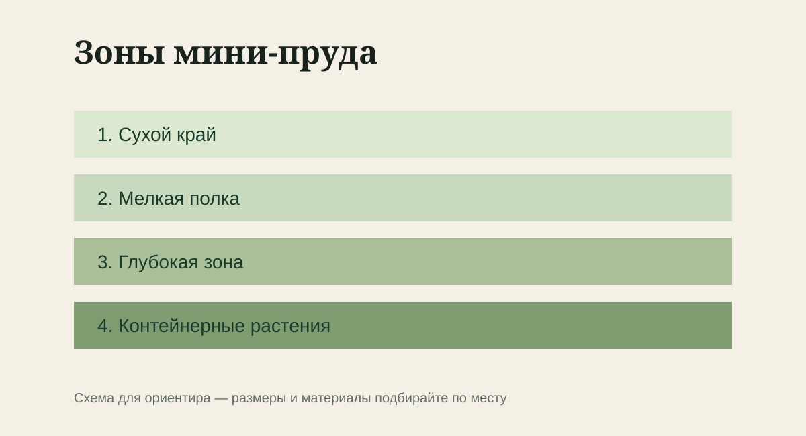

Небольшой декоративный водоём без сложной фильтрации и дорогого оборудования. До покупки материалов сделайте разметку на земле и несколько раз пройдите будущий маршрут. Ошибки масштаба лучше увидеть до земляных работ.

Для темы «Мини-пруд на даче» не нужен длинный список покупок. Полезнее заранее понять, что вы будете менять, и оставить исходное состояние для сравнения — хотя бы на фотографии.

## Проверка условий

- сформулируйте ожидаемый результат для задачи «Мини-пруд на даче»;
- разметьте границы колышками;
- проверьте уклон уровнем;
- снимите размеры в нескольких точках;
- сделайте небольшой пробный участок;

## Как действовать

1. Выберите место с несколькими часами солнца, но без постоянного полуденного перегрева.
2. Не располагайте чашу прямо под крупным листопадным деревом.
3. Сделайте полки разной глубины для контейнерных растений.
4. Край выведите строго по уровню до заполнения водой.
5. Заселяйте растения постепенно и не перекармливайте воду удобрениями.

> **Оставьте контрольный ориентир.** Сфотографируйте исходное состояние по теме «Мини-пруд на даче», чтобы через несколько дней сравнивать факты, а не впечатления.

## Через несколько дней

- после дождя не образуются лужи;
- края и бордюры не расходятся;
- покрытие не проседает под ногой;
- маршрут остаётся удобным с тачкой и инструментом;
- сравните итог по теме «Мини-пруд на даче» с исходной фотографией;

## Типичные промахи

- начинать «мини-пруд на даче» в спешке, не проверив исходные условия;
- повторять процедуру автоматически, хотя причина уже изменилась;
- оценивать результат только по поверхности и не смотреть на влагу, крепления или состояние внутри системы.

## Памятка на сезон

Сохраните короткую запись: дата, погода, что именно сделали и что увидели через несколько дней. Для темы «Мини-пруд на даче» такая заметка полезнее универсальной схемы, потому что учитывает именно ваш участок.
